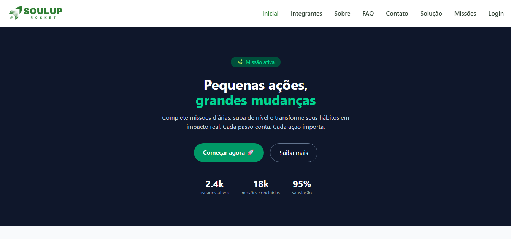
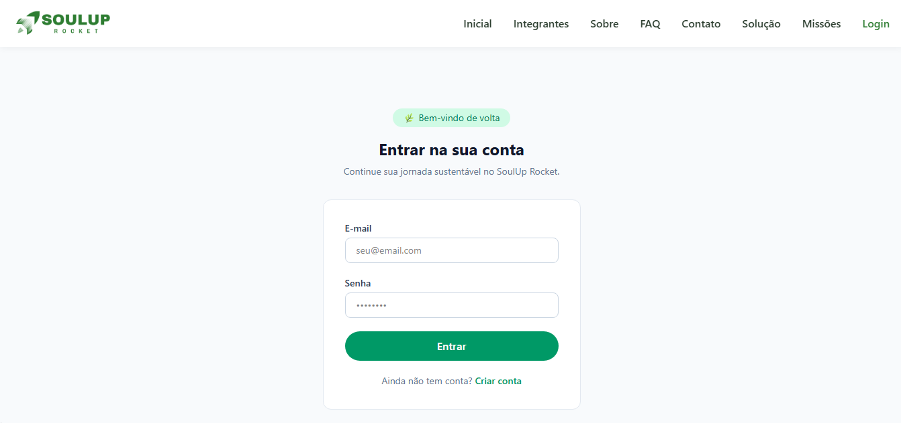
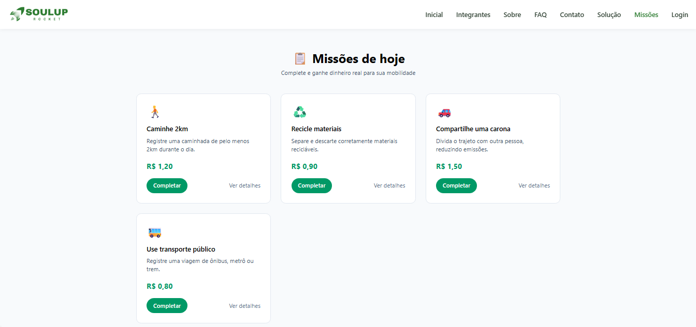

# 🚀 SoulUp Rocket

Plataforma que transforma ações sustentáveis do dia a dia em créditos reais para transporte público, unindo mobilidade urbana e sustentabilidade em uma única experiência gamificada.

> Desenvolvido pela equipe **Rocket** para o Challenge FIAP 2026 — 1º ano, Análise e Desenvolvimento de Sistemas, em parceria com a SoulUp.

---

## 📌 Sobre o projeto

Muitas pessoas deixam de utilizar o transporte público por causa do custo diário das passagens, enquanto ações sustentáveis do cotidiano não recebem incentivo suficiente para gerar impacto real. O **SoulUp Rocket** resolve os dois problemas ao mesmo tempo: os usuários completam missões diárias sustentáveis (como caminhar, reciclar ou compartilhar caronas), acumulam **EcoCoins** e trocam esse saldo por vouchers de transporte público.

### Funcionalidades

- 👤 Cadastro e login de usuários com CPF e senha, com validação de formulários
- 📋 Listagem das missões do usuário logado, com detalhes de cada missão
- ✅ Conclusão de missões, que soma EcoCoins ao saldo
- 🎟️ Geração e listagem de vouchers de transporte, trocando EcoCoins por passagem
- 🔐 Sessão do usuário mantida no navegador, com botão de sair
- 📱 Interface responsiva para celular, tablet e desktop
- 🧭 Página 404 e redirecionamentos com mensagens ao usuário

---

## 🛠️ Tecnologias utilizadas

<p>
  
  
  
  
  
  
  
  
  
</p>

- **Front-end:** React + Vite + TypeScript, SPA com React Router
- **Estilização:** Tailwind CSS (responsividade com `sm:`, `md:`, `lg:`)
- **Formulários:** React Hook Form com validações tipadas
- **Back-end:** API REST em Java (Spring Boot), publicada no Render
- **Deploy:** Vercel (front-end) e Render (API)

---

## 🧭 Páginas e rotas

| Rota | Página | Descrição |
|---|---|---|
| `/` | Home | Apresentação da plataforma |
| `/integrantes` | Integrantes | Equipe, RM, turma e links |
| `/sobre` | Sobre | Objetivo e proposta do projeto |
| `/faq` | FAQ | Perguntas frequentes |
| `/contato` | Contato | Formulário com validação |
| `/solucao` | Solução | Como a solução funciona |
| `/missoes` | Missões | Lista das missões do usuário (requer login) |
| `/missoes/:id` | Detalhe da missão | Rota dinâmica com `useParams` |
| `/vouchers` | Vouchers | Lista e geração de vouchers (requer login) |
| `/login` | Login | Acesso com CPF e senha |
| `/cadastro` | Cadastro | Criação de conta |
| `/home` | — | Redireciona para `/` |
| `*` | Não encontrada | Página 404 |

---

## 🔌 Integração com a API

O front-end consome a API publicada através da camada `src/services/api.ts`, com as respostas tipadas em `src/types/index.ts`. Os componentes não fazem requisições diretamente.

| Método | Endpoint | Uso |
|---|---|---|
| `GET` | `/missoes?cpf=` | Lista as missões do usuário |
| `GET` | `/missoes/:id` | Detalhe de uma missão |
| `POST` | `/missoes` | Cria uma missão |
| `PATCH` | `/missoes/:id/concluir` | Conclui a missão e soma pontos |
| `POST` | `/usuarios` | Cadastra um usuário |
| `POST` | `/usuarios/login` | Login com CPF e senha |
| `GET` | `/usuarios/cpf/:cpf` | Busca o usuário para atualizar o saldo |
| `GET` | `/vouchers?cpf=` | Lista os vouchers do usuário |
| `POST` | `/vouchers` | Gera um voucher |

> Na primeira requisição a API pode levar até 1 minuto para responder, porque o plano gratuito do Render coloca o serviço em repouso.

Todas as telas que dependem da API tratam três estados: **carregando**, **erro** e **lista vazia**.

---

## 📁 Estrutura de pastas

```
SOUL-UP---Challenger/
├── public/
│   └── favicon.png
├── src/
│   ├── assets/
│   │   └── imgs/
│   ├── components/
│   │   ├── Cabecalho/
│   │   ├── Carregando/
│   │   ├── MensagemErro/
│   │   ├── MensagemVazia/
│   │   ├── Menu/
│   │   └── Rodape/
│   ├── data/
│   │   └── missoes.ts
│   ├── pages/
│   │   ├── Cadastro/
│   │   ├── Contato/
│   │   ├── Faq/
│   │   ├── Home/
│   │   ├── Integrantes/
│   │   ├── Login/
│   │   ├── MissaoDetalhe/
│   │   ├── Missoes/
│   │   ├── NaoEncontrada/
│   │   ├── Sobre/
│   │   ├── Solucao/
│   │   └── Vouchers/
│   ├── routes/
│   │   └── AppRoutes.tsx
│   ├── services/
│   │   ├── api.ts
│   │   └── sessao.ts
│   ├── types/
│   │   └── index.ts
│   ├── App.tsx
│   ├── index.css
│   └── main.tsx
├── index.html
├── package.json
├── tsconfig.json
├── vercel.json
└── vite.config.ts
```

---

## 👥 Autores e créditos

| Foto | Nome | RM | Turma | Links |
|---|---|---|---|---|
|  | Sabrina Fraga Lima | 572548 | 1TDSPJ | [GitHub](https://github.com/sabrinafraga) · [LinkedIn](https://www.linkedin.com/in/sabrina-fraga-562777403/) |
|  | Tailyni Victoria Renovato Satirio | 570517 | 1TDSPJ | [GitHub](https://github.com/TailyniDev) · [LinkedIn](https://www.linkedin.com/in/tailynisatiriodev/) |
|  | Gabriel Tadeu | 571074 | 1TDSPJ | [GitHub](https://github.com/Tadeul) · [LinkedIn](https://www.linkedin.com/in/gabriel-tadeu-telles-brando-330216337/) |

---

## 🖼️ Imagens e ícones do projeto







---

## ▶️ Como usar

### Rodando localmente

Pré-requisito: [Node.js](https://nodejs.org/) 20 ou superior.

```bash
# clone o repositório
git clone https://github.com/TailyniDev/SOUL-UP---Challenger.git

# entre na pasta do projeto
cd SOUL-UP---Challenger

# instale as dependências
npm install

# rode o projeto
npm run dev
```

O projeto ficará disponível em `http://localhost:5173` (porta padrão do Vite).

### Scripts disponíveis

| Comando | O que faz |
|---|---|
| `npm run dev` | Inicia o servidor de desenvolvimento |
| `npm run build` | Verifica os tipos e gera o build de produção |
| `npm run preview` | Abre o build de produção localmente |
| `npm run lint` | Analisa o código com o oxlint |

### Configurando a API

Por padrão o projeto usa a API publicada no Render. Para apontar para outra URL (por exemplo, uma API local), crie um arquivo `.env` na raiz:

```
VITE_API_URL=http://localhost:8080
```

### Como testar a aplicação

1. Acesse **Cadastro** e crie uma conta com nome, CPF, e-mail e senha.
2. Faça **Login** com o CPF e a senha.
3. Em **Missões**, gere as missões do dia e complete algumas para ganhar EcoCoins.
4. Em **Vouchers**, gere um voucher trocando seus EcoCoins por passagem.

### Links importantes

- 🔗 **Repositório GitHub:** https://github.com/TailyniDev/SOUL-UP---Challenger
- 🌐 **Deploy (Vercel):** https://soul-up-challenger-vite.vercel.app/
- ⚙️ **API publicada (Render):** https://rocket-api-0me7.onrender.com
- 💻 **Repositório da API:** https://github.com/Tadeul/rocket-api
- 🎥 **Vídeo de apresentação (YouTube):** https://youtu.be/uJxVWLbzB_8

---

## 📬 Contato

- 📧 challenge@soulup.com
- 🤝 Parceria SoulUp + FIAP · Challenge 2º Semestre 2026

---

© 2026 SoulUp Rocket — Equipe Rocket
